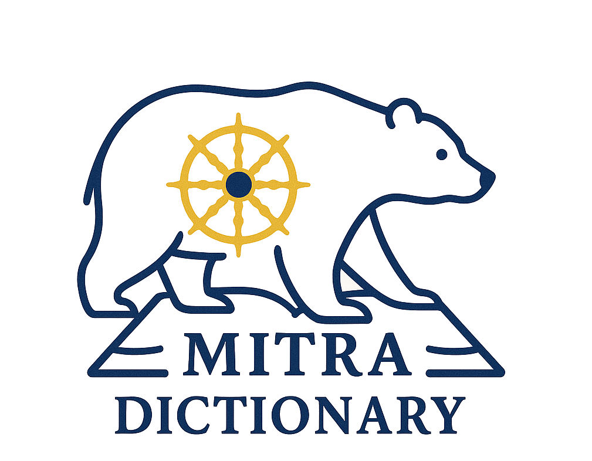

<p align="center">
  
</p>

# Dharmamitra StarDict Dictionaries

Bilingual and multilingual dictionaries for Sanskrit, Tibetan and Buddhist Chinese, generated automatically from parallel texts by [Dharmamitra](https://dharmamitra.org). They are available for GoldenDict and other StarDict viewers, and as native macOS dictionaries for Dictionary.app.

## MITRA Lexica (October 2026)

The **MITRA Tibetan Lexicon** and the **MITRA Sanskrit Lexicon** are the current release. Each entry lists how a word is rendered in the other languages of the corpus, how often each rendering is attested, grammatical information, and cited example passages with the word highlighted in both languages and linked to the source text on dharmamitra.org.

### Downloads

| Dictionary | GoldenDict / StarDict | macOS Dictionary.app |
|---|---|---|
| MITRA Tibetan Lexicon (2026.10.20) | [mitra-stardict-tib-lexicon-2026.zip](https://dharmamitra.org/pub/dictionaries/mitra-stardict-tib-lexicon-2026.zip) (362 MB) | [mitra-appledict-tib-lexicon-2026.zip](https://dharmamitra.org/pub/dictionaries/mitra-appledict-tib-lexicon-2026.zip) (574 MB) |
| MITRA Sanskrit Lexicon (2026.10.20) | [mitra-stardict-skt-lexicon-2026.zip](https://dharmamitra.org/pub/dictionaries/mitra-stardict-skt-lexicon-2026.zip) (282 MB) | [mitra-appledict-skt-lexicon-2026.zip](https://dharmamitra.org/pub/dictionaries/mitra-appledict-skt-lexicon-2026.zip) (527 MB) |

SHA-256 checksums: [SHA256SUMS-lexicon-2026.txt](https://dharmamitra.org/pub/dictionaries/SHA256SUMS-lexicon-2026.txt)

After unzipping, the StarDict versions take about 385 MB (Tibetan) and 294 MB (Sanskrit). Installed, the macOS versions take 628 MB and 609 MB.

### Statistics

| | MITRA Tibetan Lexicon | MITRA Sanskrit Lexicon |
|---|---:|---:|
| Headwords | 237,545 | 331,755 |
| Additional lookup keys (synonyms) | 487,554 | 647,275 |
| Numbered senses | 273,622 | 279,215 |
| Cited example passages | 1,051,396 | 967,923 |
| Entries with English renderings | 153,291 | 234,313 |
| Entries with Sanskrit renderings | 140,477 | — |
| Entries with Tibetan renderings | — | 148,317 |
| Entries with Chinese renderings | 72,561 | 51,292 |
| Linked source texts on dharmamitra.org | 9,035 | 4,107 |
| Minimum attestations | 3 per entry | 2 per rendering |

**Tibetan Lexicon.** Headwords are Tibetan stems in Wylie. Tibetan script, with and without the final tsheg, and inflected forms such as the agentive *bla mas* or terminative *bla mar* are lookup keys that lead to the same entry. Entries include part-of-speech profiles from a Classical Tibetan tagger, verb paradigms, and cross-references to derived forms, variants, and synonyms recorded in the Hopkins, 84000 and Rangjung Yeshe glossaries. 211,531 entries have one sense and 26,014 have two or more.

**Sanskrit Lexicon.** Headwords are Sanskrit lemmas in IAST, following the Digital Corpus of Sanskrit. 257,909 lemma entries carry senses, grammatical profiles and references to Böhtlingk & Roth (PWG). A further 73,846 entries are attested inflected forms (e.g. *atītam*, *gatvā*), each pointing to its root. Diacritic-free and hyphen-free spellings (`prajna`, `sarvadharma`) are lookup keys, so IAST input is optional. The 1,258 spellings that belong to two headwords (e.g. *āha* as a noun and as the perfect of *ah*) are merged into one entry with both articles.

The entries were drafted by a language model (Gemini 3.8 Flash) from word alignments in the Dharmamitra parallel corpora and completed from reference dictionaries for senses, names and equivalents that the corpora do not attest (Tibetan: Negi, Tibetan-language, biographical and encyclopedic dictionaries, Verbinator; Sanskrit: ITLR, Negi, Mahāvyutpatti, 84000, Hopkins, Lokesh Chandra, Hirakawa). Every corpus-based entry or rendering meets the attestation minimum shown above.

### Installation

**GoldenDict / GoldenDict-ng (Windows, Linux, macOS)**
1. Unzip the StarDict zip into a folder of your choice.
2. In GoldenDict, go to *Edit → Dictionaries → Sources → Files*, add that folder and click *Rescan*.

**macOS Dictionary.app**
1. Unzip the Apple zip. You get `mitra-tib-llm-2026.dictionary` or `mitra-skt-llm-2026.dictionary`.
2. Move it to `~/Library/Dictionaries/` (in Finder: *Go → Go to Folder…* and paste the path).
3. Open Dictionary.app, go to *Settings*, and tick **MITRA Tibetan Lexicon** / **MITRA Sanskrit Lexicon**. Drag them up the list to change their order.

The words are then also available through *Look Up* (three-finger tap or Ctrl-Cmd-D) in any macOS app. To update, replace the old `.dictionary` folder and restart Dictionary.app.

## MITRA Chinese Buddhist Dictionary (November 2026)

The **MITRA Chinese Buddhist Dictionary** covers the vocabulary of the Chinese Buddhist canon (Taishō). Each entry gives English senses where an English translation is attested, the Sanskrit and Tibetan equivalents found in parallel texts with their frequencies, a part-of-speech profile, and cited example passages with the word highlighted in both languages and linked to the source text on dharmamitra.org.

### Downloads

| Dictionary | GoldenDict / StarDict | macOS Dictionary.app |
|---|---|---|
| MITRA Chinese Buddhist Dictionary (2026.11.17) | [mitra-stardict-chn-lexicon-2026.zip](https://dharmamitra.org/pub/dictionaries/mitra-stardict-chn-lexicon-2026.zip) (232 MB) | [mitra-appledict-chn-lexicon-2026.zip](https://dharmamitra.org/pub/dictionaries/mitra-appledict-chn-lexicon-2026.zip) (376 MB) |

SHA-256 checksums: [SHA256SUMS-lexicon-2026.txt](https://dharmamitra.org/pub/dictionaries/SHA256SUMS-lexicon-2026.txt)

After unzipping, the StarDict version takes about 234 MB. Installed, the macOS version takes 372 MB.

### Statistics

| | MITRA Chinese Buddhist Dictionary |
|---|---:|
| Headwords | 171,446 |
| Additional lookup keys (synonyms) | 116,760 |
| Cited example passages | 769,314 |
| Entries with English senses | 76,420 |
| Entries with Sanskrit equivalents | 109,044 |
| Entries with Tibetan equivalents | 118,232 |
| Linked source texts on dharmamitra.org | 4,153 |

Headwords are in traditional characters; simplified forms and variants are lookup keys that lead to the same entry. The English senses were drafted by a language model (Gemini 3.8 Flash) from published English translations of the Chinese texts (48,326 entries) and from English translations of their Tibetan and Sanskrit parallels (45,861 entries). The 95,026 entries for which no English is attested list their Sanskrit and Tibetan equivalents only. Tibetan is given in Wylie and in Tibetan script. Passages marked as located from Hirakawa's dictionary were found by searching the corpus for pairs recorded in Hirakawa's *Buddhist Chinese-Sanskrit Dictionary*.

Installation works as described for the lexica above; the macOS bundle is `mitra-chn-llm-2026.dictionary` and appears in Dictionary.app as **MITRA Chinese Buddhist Dictionary**.

## Pairwise dictionaries (September 2026)

Six directional dictionaries between Sanskrit, Tibetan and Chinese, extracted from word alignments in parallel sentences.

Each entry opens with the list of all renderings in the other language, ranked by how often they occur, with counts and shares. Below that, example sentence pairs for the most frequent renderings show the word highlighted on both sides, with links to the source texts on dharmamitra.org. Tibetan is always given in Tibetan script with Wylie alongside, both for headwords and renderings and in the example sentences. Noisy pairings and function words have been filtered out.

| Direction | Headwords | Aligned occurrences | GoldenDict / StarDict | macOS Dictionary.app |
|---|---:|---:|---|---|
| Sanskrit → Tibetan | 866,021 | 6,875,779 | [mitra-stardict-skt-tib-2026-09-26.zip](https://dharmamitra.org/pub/dictionaries/mitra-stardict-skt-tib-2026-09-26.zip) (244 MB) | [mitra-appledict-skt-tib-2026-09-26.zip](https://dharmamitra.org/pub/dictionaries/mitra-appledict-skt-tib-2026-09-26.zip) (1.06 GB) |
| Tibetan → Sanskrit | 600,018 | 6,875,779 | [mitra-stardict-tib-skt-2026-09-26.zip](https://dharmamitra.org/pub/dictionaries/mitra-stardict-tib-skt-2026-09-26.zip) (254 MB) | [mitra-appledict-tib-skt-2026-09-26.zip](https://dharmamitra.org/pub/dictionaries/mitra-appledict-tib-skt-2026-09-26.zip) (853 MB) |
| Chinese → Tibetan | 329,328 | 2,132,221 | [mitra-stardict-chn-tib-2026-09-26.zip](https://dharmamitra.org/pub/dictionaries/mitra-stardict-chn-tib-2026-09-26.zip) (166 MB) | [mitra-appledict-chn-tib-2026-09-26.zip](https://dharmamitra.org/pub/dictionaries/mitra-appledict-chn-tib-2026-09-26.zip) (433 MB) |
| Tibetan → Chinese | 320,516 | 2,132,221 | [mitra-stardict-tib-chn-2026-09-26.zip](https://dharmamitra.org/pub/dictionaries/mitra-stardict-tib-chn-2026-09-26.zip) (164 MB) | [mitra-appledict-tib-chn-2026-09-26.zip](https://dharmamitra.org/pub/dictionaries/mitra-appledict-tib-chn-2026-09-26.zip) (469 MB) |
| Sanskrit → Chinese | 166,315 | 1,347,447 | [mitra-stardict-skt-chn-2026-09-26.zip](https://dharmamitra.org/pub/dictionaries/mitra-stardict-skt-chn-2026-09-26.zip) (44 MB) | [mitra-appledict-skt-chn-2026-09-26.zip](https://dharmamitra.org/pub/dictionaries/mitra-appledict-skt-chn-2026-09-26.zip) (173 MB) |
| Chinese → Sanskrit | 99,230 | 1,347,447 | [mitra-stardict-chn-skt-2026-09-26.zip](https://dharmamitra.org/pub/dictionaries/mitra-stardict-chn-skt-2026-09-26.zip) (40 MB) | [mitra-appledict-chn-skt-2026-09-26.zip](https://dharmamitra.org/pub/dictionaries/mitra-appledict-chn-skt-2026-09-26.zip) (105 MB) |

SHA-256 checksums: [SHA256SUMS-pairwise-2026-09-26.txt](https://dharmamitra.org/pub/dictionaries/SHA256SUMS-pairwise-2026-09-26.txt)

- **Aligned occurrences** counts the aligned word pairs behind a direction; both directions of a language pair share them.
- **Tibetan** headwords can be looked up in Wylie or in Tibetan script, with or without the final tsheg.
- After unzipping, the Sanskrit ↔ Tibetan StarDicts take about 2.8–3 GB each, and the other four 40–170 MB.
- Installation works as described for the lexica above. The macOS zips contain ready-built `.dictionary` bundles, which take 105 MB–1.3 GB once installed.

## Limitations

- All entries are generated automatically and have not been checked by hand. In the pairwise dictionaries, the boundaries of multi-word phrases are not always reliable. Renderings, sense divisions and grammatical labels can be wrong, and rare words are under-represented. Treat them as pointers into the texts, not as authoritative definitions, and check the cited passages.

## License

These dictionaries are released under the [Creative Commons Attribution-ShareAlike 4.0 International License (CC BY-SA 4.0)](https://creativecommons.org/licenses/by-sa/4.0/).

## Acknowledgments

These dictionaries are created by Sebastian Nehrdich and Kurt Keutzer in the context of the [Dharmamitra.org](https://dharmamitra.org) project, with generous support from the Tsadra Foundation.
We are dedicated to making work on Sanskrit, Tibetan, and Buddhist Chinese easier.

## Citation

```bibtex
@inproceedings{nehrdich-2022-sanstib,
    title = "{S}ans{T}ib, a {S}anskrit - {T}ibetan Parallel Corpus and Bilingual Sentence Embedding Model",
    author = "Nehrdich, Sebastian",
    booktitle = "Proceedings of the Thirteenth Language Resources and Evaluation Conference",
    month = jun,
    year = "2022",
    address = "Marseille, France",
    publisher = "European Language Resources Association",
    url = "https://aclanthology.org/2022.lrec-1.724",
    pages = "6728--6734"
}
```

---

<p align="center">
A project of <a href="https://dharmamitra.org">Dharmamitra.org</a>
</p>
